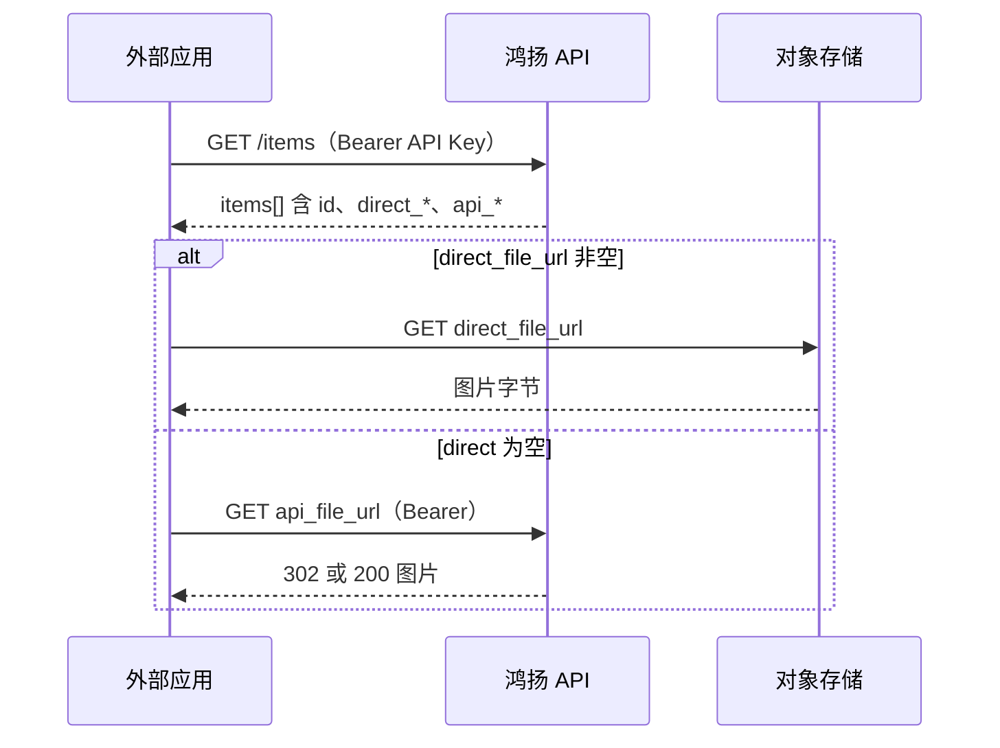

# 素材库对外只读 API

供外部系统读取鸿扬获客素材库中的图片（列表、元数据、原图与缩略图）。与 PC 素材库共用权限模型：调用身份能看到的图库，接口才能读到。

## 基础信息

| 项 | 值 |
| --- | --- |
| 生产基址 | `https://ai.hi-run.net` |
| API 前缀 | `/api/integrations/material-library` |
| 协议 | HTTPS |
| 数据格式 | JSON（列表/详情）；图片接口为二进制或 302 跳转 |
| 鉴权方式 | HTTP Header：`Authorization: Bearer <令牌>` |

令牌二选一：

- **API Key（推荐）**：完整密钥形如 `yxkey_` + 48 位十六进制，仅创建时展示一次。
- **JWT**：PC 登录后获得的访问令牌（与浏览器会话相同，适合短期调试）。

未带令牌或令牌无效时，接口返回 **401**，响应体示例：

```json
{
  "detail": "请登录后再访问"
}
```

业务错误（如无权限、素材不存在）返回 **4xx**，素材库相关错误常为：

```json
{
  "detail": {
    "error": {
      "code": "MATERIAL_NOT_FOUND",
      "message": "素材不存在"
    }
  }
}
```

---

## 如何获取 API Key

### 方式一：PC 界面（推荐）

1. 使用**管理员或具备素材库访问权限**的账号登录 PC（`https://ai.hi-run.net`）。
2. 打开右上角 **设置** → **账户** 页签。
3. 在 **API Key 管理** 区域点击 **创建 API Key**，填写名称（如「VisioFlow 素材同步」）。
4. 创建成功后弹窗中的 **`secret` 即为完整密钥**（以 `yxkey_` 开头）。**只显示这一次**，请复制到外部系统的密钥管理里；页面 thereafter 仅显示前缀（如 `yxkey_abc123****`）。
5. 可通过 **重新生成** 轮换密钥（旧密钥立即失效）。

说明：

- 普通用户只能为自己创建 Key；超级管理员可为指定用户创建（见方式二 `user_id`）。
- Key 绑定创建时指定的用户：**该用户在 PC 上能访问的企业/个人图库，接口才能读到**。
- 建议为对接系统单独建一个**服务账号**（管理员角色 + 已绑定部门），再为该账号创建 Key，避免与个人账号混用。

### 方式二：HTTP 管理接口（需已登录 JWT）

| 方法 | 路径 | 说明 |
| --- | --- | --- |
| GET | `/api/user/apikey/` | 列出当前用户可见的 Key（不含完整 secret） |
| POST | `/api/user/apikey/` | 创建 Key |

**创建请求体：**

```json
{
  "name": "外部系统名称",
  "expires_at": null,
  "user_id": null,
  "department_id": null
}
```

| 字段 | 说明 |
| --- | --- |
| `name` | 必填，备注名 |
| `expires_at` | 可选，ISO8601 过期时间；省略表示永不过期 |
| `user_id` | 可选，仅 superadmin 可为其他用户创建 |
| `department_id` | 可选，部门级 Key（少见；一般留空并绑定 `user_id`） |

**创建成功响应：**

```json
{
  "api_key": {
    "id": 1,
    "key_prefix": "yxkey_a1b2c3d4",
    "name": "外部系统名称",
    "is_enabled": true,
    "expires_at": null,
    "last_used_at": null,
    "created_at": "2026-10-21T09:00:00"
  },
  "secret": "yxkey_xxxxxxxxxxxxxxxxxxxxxxxxxxxxxxxxxxxxxxxx"
}
```

调用素材库集成接口时，Header 为：

```http
Authorization: Bearer yxkey_xxxxxxxx...
```

---

## 集成接口一览

| 方法 | 路径 | 说明 |
| --- | --- | --- |
| GET | `/items` | 分页列表 |
| GET | `/items/{item_id}` | 单条详情 + 下载地址 |
| GET | `/items/{item_id}/file` | 原图（优先 302 到 OSS） |
| GET | `/items/{item_id}/thumbnail` | 缩略图 WebP（优先 302） |

以下路径均相对于前缀 `/api/integrations/material-library`。

---

### GET `/items` — 素材列表

**Query 参数：**

| 参数 | 必填 | 说明 |
| --- | --- | --- |
| `material_type` | 是 | `image`（图片）或 `cover_template`（封面模板） |
| `category` | 否 | 图库 ID（与 PC 素材库分类 code 一致） |
| `scope` | 否 | `private` 个人 / `enterprise` 企业共享 |
| `status` | 否 | 如 `enabled` |
| `query` | 否 | 名称关键字，最长 100 字符 |
| `page` | 否 | 页码，默认 1 |
| `page_size` | 否 | 每页条数，默认 24，最大 100 |
| `sort` | 否 | `newest` / `oldest` / `name` |

**响应示例（结构）：**

```json
{
  "items": [
    {
      "id": "mli_xxxxxxxx",
      "name": "客厅效果图",
      "material_type": "image",
      "category": "gallery_code",
      "category_name": "案例图库",
      "visibility": "enterprise",
      "file_name": "photo.webp",
      "content_type": "image/webp",
      "width": 1920,
      "height": 1080,
      "storage_status": "completed",
      "file_url": "/api/material-library/items/mli_xxx/file",
      "api_file_url": "https://ai.hi-run.net/api/integrations/material-library/items/mli_xxx/file",
      "api_thumbnail_url": "https://ai.hi-run.net/api/integrations/material-library/items/mli_xxx/thumbnail",
      "direct_file_url": "https://minio.example/presigned...",
      "direct_thumbnail_url": "https://minio.example/presigned..."
    }
  ],
  "total": 120,
  "page": 1,
  "page_size": 24,
  "upload_failures": [],
  "pending_upload_count": 0
}
```

**字段说明：**

| 字段 | 说明 |
| --- | --- |
| `direct_file_url` / `direct_thumbnail_url` | MinIO 预签名直链；原图未入库或 OSS 无对象时为 `null` |
| `api_file_url` / `api_thumbnail_url` | 经本系统回源，**每次请求需带 Bearer** |
| `storage_status` | `pending` 表示原图仍在入库，直链可能不可用，请用 `api_*` 或稍后重试 |

环境变量 **`MATERIAL_INTEGRATION_PRESIGN_DAYS`**（默认 1，最大 7）控制预签名有效期（天）。

---

### GET `/items/{item_id}` — 单条详情

路径参数 `item_id` 为列表中的 `id`。

响应为单条对象，字段同列表项，并保证包含 `api_*` 与 `direct_*` 四类 URL。

**常见错误：**

| HTTP | code | 含义 |
| --- | --- | --- |
| 404 | `MATERIAL_NOT_FOUND` | 无此素材或当前身份不可见 |
| 403 | `MATERIAL_PERMISSION_DENIED` | 岗位/图库权限不足 |

---

### GET `/items/{item_id}/file` — 原图

1. 若原图已在 OSS：响应 **302**，`Location` 为预签名 URL；客户端应跟随跳转下载。
2. 否则：响应 **200**，Body 为图片二进制，`Content-Type` 为实际类型（多为 `image/webp`），`Content-Disposition: inline`。

每次请求均需 `Authorization: Bearer ...`（302 后的 OSS URL 通常不再带 Bearer，由预签名参数授权）。

---

### GET `/items/{item_id}/thumbnail` — 缩略图

逻辑同原图接口；回源时为 **WebP**，`Content-Type: image/webp`。

若 OSS 尚无缩略图对象，服务端可能现场生成并上传后再返回（首请求略慢）。

---

## 对接流程建议



1. 用**服务账号**创建 API Key，确认该账号在 PC 上能打开目标企业图库。
2. 调用 **列表** 获取 `item_id`；需要图库 ID 时，可在 PC 素材库 URL 或 `/api/material-library/galleries`（同样需 Bearer）中查看。
3. 展示缩略图优先 `direct_thumbnail_url`，失败再用 `api_thumbnail_url` 并携带 Bearer。
4. 下载原图同理；大文件建议使用直链减轻 API 压力。
5. 条目含 `work_asset_id` 时，表示作品/生图归档资产，直链逻辑仍通过上述四个 URL 暴露，与 PC 行为一致。

---

## OpenAPI

部署环境可在浏览器访问 **`https://ai.hi-run.net/docs`**（若已开启 FastAPI Swagger）查看 `material-integration` 分组下的 schema；生产若关闭文档，以本文为准。

---

## 变更记录

见 [changelog](./changelog.md) 中「`/api/integrations/material-library`」条目。
